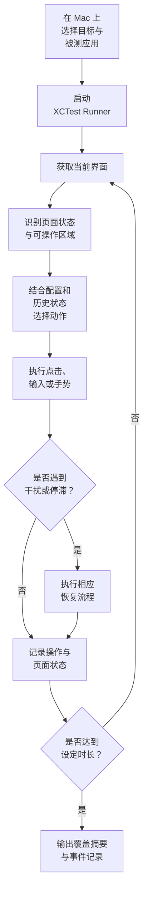

<div align="center">


# Peregrine

**面向 iOS 真机与模拟器的自主 UI 探索与自动化测试工具**

[](https://developer.apple.com/ios/)
[](https://developer.apple.com/xcode/)
[](https://developer.apple.com/documentation/xctest)
[](https://www.python.org/)
[](https://cocoapods.org/)
[](https://github.com/swisspol/GCDWebServer)
[](https://github.com/danielpaulus/go-ios/releases/tag/v1.3.2)
[](https://github.com/doronz88/pymobiledevice3)
[](LICENSE)

无需为每条探索路径编写UI测试脚本。Peregrine 在已连接的 iPhone 或已启动的模拟器上启动已安装的应用，自动识别当前界面、执行交互、探索不同页面，并记录测试过程与页面访问情况。真机与模拟器的差异见[使用手册](Doc/handbook-cn.md#真机与模拟器)。

[简体中文](README.md) · [English](README_en.md)

[核心能力](#核心能力) · [工作方式](#工作方式) · [架构概览](#架构概览) · [快速开始](#快速开始) · [文档](#文档)

</div>

---

## 为什么选择 Peregrine？

传统 UI 自动化通常依赖预先编写的测试用例：测试路径由人设计，页面或交互发生变化后，脚本也可能需要维护。人工走查则容易受到时间、操作路径和重复劳动的限制。

**Peregrine 将自主探索引入 iOS 真机与模拟器测试。** 它根据当前界面和历史探索状态选择下一步操作，并针对常见弹窗、页面遮挡、应用离开前台和界面停滞提供恢复机制。测试结束后，生成页面覆盖摘要和逐步事件记录，帮助测试人员了解本轮探索实际执行了什么，遇到了哪些异常情况，便于更深层次发现潜在的缺陷问题。

Peregrine 适用于发布前的补充探索、应用界面稳定性检查，以及需要快速发现未预先规划页面路径的测试场景。它可以补充现有自动化测试流程，但不能替代有明确断言和业务验证目标的功能测试。

## 核心能力

### 自主探索真实 iOS 应用

在已连接的 iPhone 或已启动的模拟器上运行 XCTest UI 测试，通过当前画面选择点击、滑动、输入等操作，持续探索应用界面。基础探索不要求修改或重新编译被测应用。

### 多种界面识别方式

提供截图、XCTest 快照和组合模式。默认组合模式以截图识别为基础，并在适当情况下利用公开 XCTest 快照校正点击目标。对于可以集成 `peregrine-stub` 的调试版本，还可选择应用内控件树作为增强信息来源。

### 面向探索覆盖的动作选择

记录界面状态及状态之间的跳转，优先尝试当前页面尚未操作的控件，并利用历史探索信息引导后续动作。跨轮复用文件可保存已发现的动作与页面关系，为后续探索提供参考。

### 常见干扰场景的检测与恢复

针对系统或应用弹窗、应用失去前台、外部页面、付费墙、广告、图片预览和画面停滞等场景提供检测及恢复流程，减少单次异常对整轮探索的影响。

### 灵活控制探索过程

支持通过配置文件设置页面范围、场景限制、操作序列和带超时的步骤；也支持从外部发送 JSON 操作指令。适用于纯自主探索，以及自主探索与指定操作相结合的测试流程。

### 可追溯的测试结果

记录页面访问情况、每一步操作的开始与结束、超时、应用状态变化及探索指标，并保留 Xcode 运行结果，方便复核测试过程和定位异常。

### 崩溃统计与日志收集

统计每轮的疑似崩溃与动作超时次数，并记录每次异常前的操作路径。真机结束后从设备拉取被测应用的崩溃日志与内存超限记录，按异常类型和调用栈去重计数，生成崩溃报告，无需在设备的「分析与改进」中手动导出。模拟器没有系统崩溃目录，只保留 Runner 自己的计数。

## 功能一览

| 能力        | 说明                                              |
|-----------|-------------------------------------------------|
| iOS UI 探索 | 在已安装的应用中执行点击、输入、长按、滑动、返回和重启等操作。真机与模拟器都支持        |
| 界面识别      | 支持 `screenshot`、`snapshot` 和 `combined` 模式      |
| 状态引导      | 根据界面状态和历史跳转信息选择探索动作                             |
| 恢复机制      | 检测并处理常见弹窗、外部页面、遮挡、前台丢失和界面停滞                     |
| 场景与步骤配置   | 支持页面限制、操作序列、带超时步骤及排除截图区域                        |
| 外部操作控制    | 通过设备本地命令端口接收 JSON 操作                            |
| 结果记录      | 输出页面覆盖摘要、JSONL 事件日志及 Xcode 结果包                  |
| 崩溃报告      | 统计崩溃与超时次数；真机收集设备崩溃日志并按类型和调用栈分组，模拟器只保留 Runner 计数 |
| 步骤截图      | 可选。按步保存带候选框与操作目标标注的截图，测试结束后打包拉回                 |
| 资源采样      | 可选。采集被测应用的内存、CPU、帧率等资源数据，并生成与操作步骤对齐的采样报告        |
| 本地启动页     | 查看已连接的 iPhone 与已启动的模拟器、已安装应用，启动或终止测试并查看日志       |

## 工作方式



## 架构概览

Peregrine 将依赖 iOS 测试运行环境的操作执行层，与负责探索决策的行为层分开，便于维护和扩展。

| 组件                   | 职责                                      |
|----------------------|-----------------------------------------|
| `PeregrineRunner`    | XCTest 入口，将测试请求交给运行组件                   |
| `peregrine-runner`   | 获取界面、执行手势、处理弹窗与恢复流程、记录事件                |
| `peregrine-behavior` | 管理配置、界面状态、动作选择、场景与覆盖信息                  |
| `peregrine-stub`（可选） | 为集成了插桩的被测应用提供控件树信息                      |
| `tools/launch/`      | 本地网页启动页与命令行：跑测试、拉回目标结果、真机收集崩溃、资源采样、打包导出 |
| `tools/crash/`       | 从真机收集崩溃日志，生成崩溃报告                        |

### 目录结构

```text
.
├── README.md                       中文说明
├── README_en.md                    英文说明
├── LICENSE                         MIT 许可证
├── Doc/
│   ├── handbook-cn.md              使用手册（中文）
│   ├── handbook-en.md              Handbook (English)
│   ├── 插桩接入.md                  被测应用接入插桩（中文）
│   └── instrumentation.md          Integrating the stub (English)
├── pic/                            项目标志：logo.svg 与 README 使用的 logo-192.png
├── tools/
│   ├── requirements.txt            电脑端资源采样的 Python 依赖
│   ├── launch/
│   │   ├── server.py               本地网页启动页的服务端
│   │   ├── cli.py                  命令行入口：install、devices、apps、run、check、stub、pull、runs、export
│   │   ├── core.py                 启动页与命令行共用：设备、应用、测试命令（Xcode 或 go-ios）、结果拉取与打包
│   │   ├── models.py               go-ios 方式下 iPhone 型号标识（如 iPhone16,2）到市场型号的对照
│   │   ├── perf.py                 电脑端资源采样与采样报告
│   │   ├── runtest.py              经 go-ios 运行手机上已安装的 Runner，并转出 Runner 日志
│   │   └── web/                    启动页前端：index.html、launch.css、launch.js；站点图标在 web/pic/
│   └── crash/collect.py            崩溃日志收集与报告
└── Peregrine/
    ├── Peregrine.xcworkspace       Xcode 工作区，包含 Peregrine 与 Pods 工程
    ├── Peregrine.xcodeproj         Xcode 工程，target PeregrineRunner、peregrine_stub
    ├── Podfile                     CocoaPods 依赖声明
    ├── Podfile.lock                CocoaPods 锁定的依赖版本
    ├── peregrine.podspec           子规格 peregrine-behavior、peregrine-runner
    ├── peregrine-stub.podspec      插桩组件
    ├── PeregrineRunner/            XCTest 入口
    ├── peregrine-runner/           依赖 XCTest 的执行层
    │   ├── run/                    一轮测试的主流程、动作选择与执行、命令端口
    │   ├── screen/                 截图、无障碍快照、插桩控件树
    │   ├── gate/                   系统弹窗、全屏广告、外部页面、拉回前台
    │   ├── record/                 事件日志、异常计数、探索得分
    │   └── network/                通信检查（testPingNetwork）
    ├── peregrine-behavior/         不依赖 UIKit 的决策层
    │   ├── session/                会话参数、配置、环境变量
    │   ├── screen/                 控件树、截图切分、插桩协议、遮挡识别
    │   ├── strategy/               状态图与动作挑选
    │   ├── operate/                动作字段与手势描述
    │   ├── scene/                  场景限制与回调
    │   ├── flow/                   卡住恢复、用例、schema 跳转
    │   ├── result/                 页面覆盖、跨轮复用
    │   └── config/                 默认配置，打进 PGBehaviorConfig.bundle
    └── peregrine-stub/             插桩源码
```

## 环境要求

编译和安装 Runner（Mac）：

- macOS 与 Xcode 15 或更高版本（`devicectl` 随 Xcode 提供）
- CocoaPods
- Python 3（启动页与命令行只使用标准库。电脑端资源采样的依赖写在 `tools/requirements.txt`，首次开启采样时会按该文件安装到 `tools/launch/.local/tools/` 下的独立虚拟环境，需要 Python 3.9 及以上；也可预先执行 `python3 -m pip install -r tools/requirements.txt`）
- 目标：通过数据线连接并已信任此 Mac 的 iPhone，或已启动的 iOS 模拟器。模拟器上的被测应用须为 `iphonesimulator` 包，见[使用手册 · 真机与模拟器](Doc/handbook-cn.md#真机与模拟器)
- 可用于安装 XCTest Runner 的 Apple 开发签名
- 已安装且能够手动启动的被测应用
- 可选：`libimobiledevice` / `ideviceinstaller`，用于在启动页中列出真机上的应用，以及收集真机崩溃日志

在 Linux 或 Windows 上运行（手机上已由 Mac 安装 Runner）：

- Python 3（电脑端资源采样另需 3.9 及以上，依赖见 `tools/requirements.txt`）
- 能访问 GitHub：go-ios 无需另行安装，首次使用时从 GitHub 下载 v1.3.2 并校验 SHA-256，存放在 `tools/launch/.local/tools/`；Windows 同时从 wintun.net 下载对应架构的 `wintun.dll`。无法联网时，可用环境变量 `GO_IOS` 指定手动下载的 go-ios
- Linux 需运行 `usbmuxd`；Windows 需安装 Apple Mobile Device Support（随 iTunes 或 Apple Devices 提供）
- 手机已开启开发者模式并信任这台电脑

## 快速开始

### 1. 获取项目并安装依赖

```bash
git clone https://github.com/zhoujun94511/Peregrine_ios
cd Peregrine_ios/Peregrine
pod install
open Peregrine.xcworkspace
```

### 2. 配置签名

在 Xcode 中打开 `Peregrine.xcworkspace`，为 `PeregrineRunner` 配置有效的 Apple 开发团队和签名。若使用自己的团队，请确认 Runner 的 Bundle Identifier 可以由该团队注册。

### 3. 启动本地网页

回到仓库根目录执行：

```bash
python3 tools/launch/server.py
```

启动页默认地址为 `http://127.0.0.1:8765/`，并监听局域网；启动时终端会打印本机局域网地址，同一网络的其他电脑可用该地址打开同一页面。只允许本机打开时设置 `PEREGRINE_LAUNCH_HOST=127.0.0.1`。在页面中选择已连接的 iPhone 或已启动的模拟器、填写被测应用的 Bundle ID，设置测试时长和操作间隔，然后开始测试。首次使用可先单击「通信检查」，确认 Runner 能在目标上正常运行。真机与模拟器都支持，差异见[使用手册](Doc/handbook-cn.md#真机与模拟器)。

<p align="center">
  
</p>

应用列表依赖 `ideviceinstaller`。如果当前环境无法列出应用，也可以使用命令行方式并直接指定 Bundle ID。

### 4. 或通过命令行运行

命令行与启动页共用同一套逻辑。隧道和安装日志在 `tools/launch/.run/`，依赖和每一轮的运行日志、结果在 `tools/launch/.local/`。在仓库根目录执行：

```bash
python3 tools/launch/cli.py devices                      # 列出已连接的 iPhone 与已启动的模拟器
python3 tools/launch/cli.py apps                         # 列出目标上的应用
python3 tools/launch/cli.py run --bundle-id com.example.app --duration 10 --export
```

`run` 结束后拉回结果文件；真机再收集崩溃日志，模拟器跳过。`--export` 再打成 zip。只连一台目标时可省略 `--udid`；开发团队默认取本机证书。其他子命令：`install`（在 Mac 上编译并安装 Runner 到真机）、`check`（通信检查）、`stub`（插桩检测；模拟器跳过电脑侧探测）、`pull`（拉回结果）、`runs`（列出运行记录）、`export`（打包某一轮），完整参数见[使用手册](Doc/handbook-cn.md#命令行)。

也可以在 `Peregrine/` 目录直接调用 `xcodebuild`：

```bash
PEREGRINE_BUNDLEID=com.example.app \
PEREGRINE_DURATION=1 \
PEREGRINE_THROTTLE=300 \
xcodebuild test \
  -workspace Peregrine.xcworkspace \
  -scheme PeregrineRunner \
  -destination 'platform=iOS,id=<device-udid>' \
  -only-testing:PeregrineRunner/PeregrineRunner/testPeregrine \
  -allowProvisioningUpdates \
  DEVELOPMENT_TEAM=<team-id>
```

请替换 Bundle ID、目标标识和 Team ID。真机 UDID 可通过 `xcrun xctrace list devices` 查询，测试期间保持 iPhone 解锁并亮屏。模拟器把 `-destination` 换成 `'platform=iOS Simulator,id=<UUID>'`，UUID 取自 `xcrun simctl list devices booted`。

### 5. 在 Linux 或 Windows 上运行

先在 Mac 上把 Runner 编译并安装到手机：

```bash
python3 tools/launch/cli.py install
```

之后将手机连接到 Linux 或 Windows 电脑，启动页与命令行的用法与 Mac 相同。没有 Xcode 时自动经 go-ios 运行，启动页标题旁显示「go-ios」，go-ios 在首次使用时自动下载，无需另行安装；在 Mac 上也可以用 `PEREGRINE_BACKEND=goios` 或 `cli.py --backend goios` 指定。iOS 17 及以上版本所需的 go-ios 隧道、开发者磁盘映像会在运行前自动准备。Runner 的签名到期或更新 Peregrine 后，须回到 Mac 重新执行 `install`。详见[使用手册](Doc/handbook-cn.md#在-linux-与-windows-上运行)。

### 6. 查看结果

测试结束后，可查看：

- `peregrine-coverage.txt`：本轮访问到的页面及访问次数。
- `peregrine-events.jsonl`：逐步事件、动作耗时、超时、应用状态变化和探索指标。
- `tools/launch/.local/rounds/run-<时间>/device/perf-report.txt`：开启资源采样时的采样报告，包括内存峰值、每次启动的内存增长斜率、内存增长最多的操作步骤、主线程卡顿等，见[使用手册](Doc/handbook-cn.md#资源采样)。
- `tools/launch/.run/`：隧道日志 `tunnel.log`，以及 Mac 上的 install 日志。删掉这个目录不会重新下载。
- `tools/launch/.local/rounds/run-<时间>/`：这一轮的日志、`device/`、`crash/` 和导出 zip 放在同一个目录里。
- 启动页的「打包导出」把本轮的运行日志、`.xcresult`、崩溃报告和设备结果文件打成一个 zip 下载；「导出日志」只下载运行日志。
- `tools/launch/.local/rounds/run-<时间>/crash/crash-report.md`：本轮的崩溃报告，包括崩溃类型、次数、调用栈和崩溃前的操作。`cli.py run` 会自动生成；直接调用 `xcodebuild` 时可用 `tools/crash/collect.py` 生成，见[使用手册](Doc/handbook-cn.md#崩溃与异常)。

## 配置与扩展

常用配置入口包括：

- `PEREGRINE_BUNDLEID`：被测应用的 Bundle ID。
- `PEREGRINE_DURATION`：探索时长，单位为分钟。
- `PEREGRINE_THROTTLE`：两步操作之间的间隔，单位为毫秒。
- `PEREGRINE_UI_SOURCE`：界面来源模式，可选 `combined`、`screenshot` 或 `snapshot`。
- `PEREGRINE_DATAPORT`：可选插桩控件树的数据端口。经启动页或 `cli.py run` 启动时，开跑前先检测被测应用是否接入插桩，未接入时本轮不传该端口。
- `PEREGRINE_COMMAND_PORT`：可选外部 JSON 操作命令端口。

页面限制、操作序列和用例步骤等更详细的配置方式，请参阅[使用手册](Doc/handbook-cn.md)。插桩接入方式、端口传递和协议说明请参阅[插桩接入文档](Doc/插桩接入.md)。

## 已知限制

- 真机与模拟器都支持探索。电脑端资源采样、系统崩溃 / Jetsam 拉取、`install` 与 go-ios 只在真机上可用。对照见[使用手册 · 真机与模拟器](Doc/handbook-cn.md#真机与模拟器)。
- Runner 只能在 Mac 上编译和签名；Linux、Windows 只能运行手机上已安装的 Runner。
- 一次运行只支持一台设备和一个被测应用。
- 截图识别通过图像区域分割定位可操作区域，不等同于语义级 OCR；复杂背景、纯图片界面或密集列表可能影响定位准确性。
- 弹窗、广告和付费墙识别依赖内置中英文关键词及规则，非预期语言或特殊界面可能无法准确识别。
- `peregrine-stub` 是可选调试能力。它通过设备本地端口提供控件树信息，服务没有基于 HTTPS 加密通信；请仅用于测试或调试版本，不要将其集成到正式发布包。
- 页面覆盖名称的准确度取决于可用的界面信息。纯截图模式可能无法区分不同页面，需结合事件日志和探索指标分析。
- 仓库当前没有单元测试和 CI 配置。
- 部分国行设备会拒绝 Runner 使用无线数据（`wifi_denied`），Runner 无法访问外网。探索、命令端口与插桩只使用设备本机端口，不受影响；只有远程 `sceneConfigURL` / `sceneCallback` 需要外网。通信链路可用 `testPingNetwork` 检查，见[使用手册](Doc/handbook-cn.md#通信检查)。

## 文档

- [使用手册](Doc/handbook-cn.md)：运行方式、真机与模拟器对照、环境变量、配置文件、结果说明、崩溃收集与资源采样
- [插桩接入](Doc/插桩接入.md)：插桩集成、端口传递、协议与真机 / 模拟器验证记录

## 许可证

本项目采用 [MIT License](LICENSE)。

## 致谢

- 可选插桩组件使用 [GCDWebServer](https://github.com/swisspol/GCDWebServer)。

- Linux、Windows 上经 [go-ios](https://github.com/danielpaulus/go-ios)（MIT 许可证）运行 Runner；Windows 隧道使用 [Wintun](https://www.wintun.net/) 的预编译 `wintun.dll`。两者均在运行时从官方地址下载，不随本仓库分发。

- 电脑端资源采样使用 [pymobiledevice3](https://github.com/doronz88/pymobiledevice3)，依赖见 `tools/requirements.txt`，首次开启采样时安装到独立虚拟环境，不随本仓库分发。
