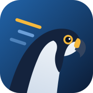
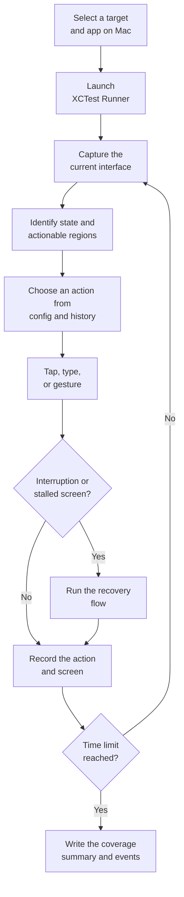
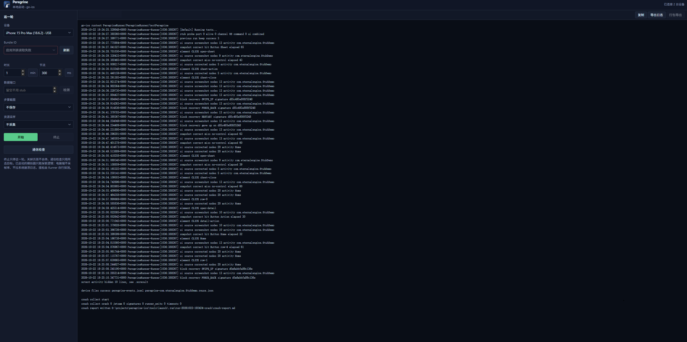

<div align="center">



# Peregrine

**Autonomous UI exploration and testing for iOS, on a physical device or the Simulator**

[](https://developer.apple.com/ios/)
[](https://developer.apple.com/xcode/)
[](https://developer.apple.com/documentation/xctest)
[](https://www.python.org/)
[](https://cocoapods.org/)
[](https://github.com/swisspol/GCDWebServer)
[](https://github.com/danielpaulus/go-ios/releases/tag/v1.3.2)
[](https://github.com/doronz88/pymobiledevice3)
[](LICENSE)

Peregrine explores installed iOS apps on a connected iPhone or a booted Simulator without requiring a hand-written script for every navigation path. It identifies the current interface, performs interactions, explores different pages, and records the test process and page visits. Differences are in the [handbook](Doc/handbook-en.md#physical-device-and-simulator).

[简体中文](README.md) · [English](README_en.md)

[Key Features](#key-features) · [How It Works](#how-it-works) · [Architecture](#architecture) · [Quick Start](#quick-start) · [Documentation](#documentation)

</div>

---

## Why Peregrine?

Traditional UI automation often relies on predefined test cases. The paths are designed in advance, and changes to screens or interactions may require script maintenance. Manual walkthroughs, meanwhile, are constrained by time and the paths a tester happens to follow.

**Peregrine brings autonomous exploration to iOS testing on a physical device and the Simulator.** It selects actions based on the current interface and previously observed states. Recovery flows address common interruptions such as alerts, overlays, loss of foreground, and stalled screens. At the end of a run, Peregrine produces a page-coverage summary and a step-by-step event log that show what the run actually did and which anomalies it ran into, helping testers uncover deeper potential defects.

Peregrine is designed for supplementary pre-release exploration, UI stability checks, and scenarios where testers want to discover navigation paths that were not explicitly scripted. It complements existing automation; it is not a replacement for functional tests with explicit assertions and business-level validation.

## Key Features

### Explore real iOS apps autonomously

Run an XCTest UI test on a connected iPhone or a booted Simulator. Peregrine chooses interactions such as taps, swipes, and text input based on the current screen. Basic exploration does not require modifying or rebuilding the app under test.

### Flexible UI observation

Choose between screenshot-based detection, XCTest snapshots, or a combined mode. The default combined mode starts with screenshot analysis and uses public XCTest snapshots to refine tap targets when appropriate. Debug builds that can integrate `peregrine-stub` can also use the in-app view tree as an additional source of information.

### State-guided action selection

Peregrine tracks interface states and transitions, prioritizes controls that have not yet been tried on the current screen, and uses exploration history to guide subsequent actions. A reuse file can preserve discovered action-to-page relationships across runs.

### Recovery from common interruptions

Detection and recovery flows cover common system and app alerts, foreground changes, external screens, paywalls, ads, image previews, and stalled interfaces. These safeguards reduce the impact of a single anomaly on the whole exploration run.

### Configurable exploration

Use configuration files to define page and scene constraints, action sequences, and timed steps. External clients can also submit JSON actions. This supports both open-ended exploration and workflows that combine autonomous behavior with predefined operations.

### Traceable results

Peregrine records page visits, action start and end events, timeouts, app state changes, and exploration metrics. Xcode run artifacts are retained to support investigation and review.

### Crash statistics and log collection

Peregrine counts suspected crashes and action timeouts in each run and records the steps before each anomaly. After a physical-phone run it pulls the crash logs and memory-limit (Jetsam) records of the app under test, groups them by exception type and call stack, and writes a crash report, so there is no need to export logs manually from Analytics & Improvements on the phone. A Simulator has no system crash directory; only the Runner's own counts are kept.

## Feature Overview

| Capability               | Description                                                                                                                                                   |
|--------------------------|---------------------------------------------------------------------------------------------------------------------------------------------------------------|
| iOS UI exploration       | Tap, type, long-press, swipe, navigate back, and restart the app. Supported on a physical phone and on the Simulator                     |
| UI observation           | `screenshot`, `snapshot`, and `combined` modes                                                                                                                |
| State-guided exploration | Select actions using interface states and historical transitions                                                                                              |
| Recovery flows           | Handle common alerts, external screens, overlays, foreground loss, and stalled screens                                                                        |
| Scenario configuration   | Configure page constraints, action sequences, timed steps, and excluded screenshot regions                                                                    |
| External control         | Receive JSON actions through a device-local command port                                                                                                      |
| Result artifacts         | Page-coverage summary, JSONL event log, and Xcode result bundle                                                                                               |
| Crash report             | Count crashes and timeouts; on a physical phone, collect device crash logs and group them by type and call stack; on a Simulator, keep only the Runner counts |
| Step screenshots         | Optional. Save per-step screenshots marked with candidate boxes and the action target, bundled and pulled back after the run                                  |
| Resource sampling        | Optional. Sample the app's memory, CPU, frame rate, and related resource data, and write a report aligned with the action steps                               |
| Local launch page        | View connected iPhones and booted Simulators, installed apps, start or stop runs, and view logs                                                               |

## How It Works



## Architecture

Peregrine separates the execution layer, which depends on the iOS test runtime, from the behavior layer, which makes exploration decisions. This keeps the project easier to maintain and extend.

| Component                   | Responsibility                                                                                                                               |
|-----------------------------|----------------------------------------------------------------------------------------------------------------------------------------------|
| `PeregrineRunner`           | XCTest entry point that hands test requests to the runner components                                                                         |
| `peregrine-runner`          | Captures interfaces, performs gestures, handles interruptions and recovery, and records events                                               |
| `peregrine-behavior`        | Manages configuration, interface states, action selection, scenarios, and coverage                                                           |
| `peregrine-stub` (optional) | Exposes view-tree information for apps that integrate the instrumentation component                                                          |
| `tools/launch/`             | Local web launcher and command line: run tests, pull target results, collect crashes on a physical phone, sample resources, and export a run |
| `tools/crash/`              | Collects crash logs from a physical phone and writes the crash report                                                                        |

### Directory Layout

```text
.
├── README.md                       Chinese README
├── README_en.md                    English README
├── LICENSE                         MIT License
├── Doc/
│   ├── handbook-cn.md              Handbook (Chinese)
│   ├── handbook-en.md              Handbook (English)
│   ├── 插桩接入.md                  Integrating the stub (Chinese)
│   └── instrumentation.md          Integrating the stub (English)
├── pic/                            Project logo: logo.svg and logo-192.png used by the README
├── tools/
│   ├── requirements.txt            Python dependencies for host-side resource sampling
│   ├── launch/
│   │   ├── server.py               Local web launcher server
│   │   ├── cli.py                  Command line: install, devices, apps, run, check, stub, pull, runs, export
│   │   ├── core.py                 Shared by launcher and CLI: devices, apps, test command (Xcode or go-ios), result pull and bundle
│   │   ├── models.py               iPhone product types (such as iPhone16,2) to marketing names, for the go-ios path
│   │   ├── perf.py                 Host-side resource sampling and the sampling report
│   │   ├── runtest.py              Runs the installed Runner through go-ios and forwards its log
│   │   └── web/                    Launcher front end: index.html, launch.css, launch.js; site icons in web/pic/
│   └── crash/collect.py            Crash log collection and report
└── Peregrine/
    ├── Peregrine.xcworkspace       Xcode workspace containing the Peregrine and Pods projects
    ├── Peregrine.xcodeproj         Xcode project, targets PeregrineRunner and peregrine_stub
    ├── Podfile                     CocoaPods dependency declaration
    ├── Podfile.lock                CocoaPods locked dependency versions
    ├── peregrine.podspec           Subspecs peregrine-behavior and peregrine-runner
    ├── peregrine-stub.podspec      Instrumentation component
    ├── PeregrineRunner/            XCTest entry point
    ├── peregrine-runner/           Execution layer, depends on XCTest
    │   ├── run/                    Run loop, action choice and playback, command port
    │   ├── screen/                 Screenshots, accessibility snapshots, instrumentation tree
    │   ├── gate/                   System alerts, full-screen ads, outside screens, foreground return
    │   ├── record/                 Event log, anomaly counts, exploration score
    │   └── network/                Communication check (testPingNetwork)
    ├── peregrine-behavior/         Decision layer, no UIKit
    │   ├── session/                Session parameters, config, environment
    │   ├── screen/                 Element tree, screenshot segmentation, stub protocol, overlay rules
    │   ├── strategy/               State graph and action selection
    │   ├── operate/                Action fields and gesture description
    │   ├── scene/                  Scene limits and callbacks
    │   ├── flow/                   Stuck recovery, scripted cases, schema jumps
    │   ├── result/                 Page coverage, cross-run reuse
    │   └── config/                 Default config, bundled as PGBehaviorConfig.bundle
    └── peregrine-stub/             Instrumentation source
```

## Requirements

To build and install the Runner (Mac):

- macOS and Xcode 15 or later (`devicectl` ships with Xcode)
- CocoaPods
- Python 3 (the launcher and the CLI use only the standard library. Host-side resource sampling reads `tools/requirements.txt` and, on first use, installs it into a separate virtual environment under `tools/launch/.local/tools/`, which needs Python 3.9 or later; you can also run `python3 -m pip install -r tools/requirements.txt` beforehand)
- A target: a physical iPhone connected by cable and trusted by the Mac, or a booted iOS Simulator. On a Simulator the app under test must be an `iphonesimulator` build; see [Physical device and Simulator](Doc/handbook-en.md#physical-device-and-simulator)
- An Apple development signing setup for installing the XCTest Runner
- The app under test installed and able to launch manually
- Optional: `libimobiledevice` / `ideviceinstaller` to list apps on a physical phone in the launcher and to collect physical-phone crash logs

To run on Linux or Windows (the Runner already installed on the phone from a Mac):

- Python 3 (host-side resource sampling needs 3.9 or later; see `tools/requirements.txt`)
- Access to GitHub: no separate go-ios install is needed; on first use go-ios v1.3.2 is downloaded from GitHub, checked against its SHA-256, and kept in `tools/launch/.local/tools/`; on Windows the matching `wintun.dll` is also downloaded from wintun.net. Offline, point the `GO_IOS` environment variable at a manually downloaded go-ios
- Linux: `usbmuxd` running; Windows: Apple Mobile Device Support (shipped with iTunes or Apple Devices)
- Developer Mode enabled on the phone, and the phone trusting this computer

## Quick Start

### 1. Clone the repository and install dependencies

```bash
git clone https://github.com/zhoujun94511/Peregrine_ios
cd Peregrine_ios/Peregrine
pod install
open Peregrine.xcworkspace
```

### 2. Configure code signing

Open `Peregrine.xcworkspace` in Xcode and configure a valid Apple development team and signing settings for `PeregrineRunner`. If you use your own team, ensure the Runner's Bundle Identifier can be registered by that team.

### 3. Start the local web launcher

From the repository root, run:

```bash
python3 tools/launch/server.py
```

The launcher defaults to `http://127.0.0.1:8765/` and also listens on the local network. The terminal prints the LAN address at startup; other computers on the same network can open that address. Set `PEREGRINE_LAUNCH_HOST=127.0.0.1` to accept local connections only. Select the connected iPhone or a booted Simulator, enter the installed app's Bundle ID, set the run duration and action interval, and start the test. On first use, click **通信检查** (communication check) to confirm the Runner works on the target. A physical phone and the Simulator are both supported; differences are in the [handbook](Doc/handbook-en.md#physical-device-and-simulator).

<p align="center">
  
</p>

The installed-app list depends on `ideviceinstaller`. If the launcher cannot list apps in your environment, you can run from the command line and provide the Bundle ID directly.

### 4. Or run from the command line

The command line shares its logic with the launcher. Tunnel and install logs are in `tools/launch/.run/`; downloads and each run's log and results are in `tools/launch/.local/`. From the repository root:

```bash
python3 tools/launch/cli.py devices                      # list connected iPhones and booted Simulators
python3 tools/launch/cli.py apps                         # list apps on the target
python3 tools/launch/cli.py run --bundle-id com.example.app --duration 10 --export
```

After `run` finishes, it pulls the result files; a physical phone then collects crash logs, a Simulator skips that step. `--export` also writes a zip. `--udid` can be omitted when one target is connected, and the team defaults to the local signing certificate. Other subcommands: `install` (build and install the Runner on a physical phone from a Mac), `check` (communication check), `stub` (stub detection; a Simulator skips the host-side probe), `pull` (pull results), `runs` (list runs), and `export` (bundle a run). See the [handbook](Doc/handbook-en.md#command-line) for all options.

You can also call `xcodebuild` directly from the `Peregrine/` directory:

```bash
PEREGRINE_BUNDLEID=com.example.app \
PEREGRINE_DURATION=1 \
PEREGRINE_THROTTLE=300 \
xcodebuild test \
  -workspace Peregrine.xcworkspace \
  -scheme PeregrineRunner \
  -destination 'platform=iOS,id=<device-udid>' \
  -only-testing:PeregrineRunner/PeregrineRunner/testPeregrine \
  -allowProvisioningUpdates \
  DEVELOPMENT_TEAM=<team-id>
```

Replace the Bundle ID, target identifier, and Team ID with your values. A physical-phone UDID is in `xcrun xctrace list devices`; keep the iPhone unlocked and its screen on during the run. For a Simulator, use `-destination 'platform=iOS Simulator,id=<UUID>'`; the UUID is in `xcrun simctl list devices booted`.

### 5. Run on Linux or Windows

First build the Runner on a Mac and install it on the phone:

```bash
python3 tools/launch/cli.py install
```

Then connect the phone to a Linux or Windows computer; the launcher and the CLI work as on the Mac. Without Xcode they run through go-ios, downloaded automatically on first use, and the launcher shows "go-ios" next to its title; on a Mac, choose it with `PEREGRINE_BACKEND=goios` or `cli.py --backend goios`. The go-ios tunnel needed by iOS 17 and later and the developer disk image are prepared before each run. When the Runner's signature expires or Peregrine is updated, run `install` on the Mac again. See the [handbook](Doc/handbook-en.md#running-on-linux-and-windows).

### 6. Review the results

After a run, inspect:

- `peregrine-coverage.txt` — pages visited and visit counts.
- `peregrine-events.jsonl` — per-step events, action timing, timeouts, app state changes, and exploration metrics.
- `tools/launch/.local/rounds/run-<time>/device/perf-report.txt` — the sampling report when resource sampling is on: memory peak, memory growth slope per launch, the steps with the largest memory growth, main-thread stalls, and more; see the [handbook](Doc/handbook-en.md#resource-sampling).
- `tools/launch/.run/` — `tunnel.log`, and install logs on a Mac. Deleting this directory does not download anything again.
- `tools/launch/.local/rounds/run-<time>/` — that run's log, `device/`, `crash/`, and export zip live in one directory.
- In the launcher, **打包导出** (export bundle) downloads one zip with the run log, `.xcresult`, crash report, and device result files of the run; **导出日志** (export log) downloads the run log only.
- `tools/launch/.local/rounds/run-<time>/crash/crash-report.md` — the crash report of the run, including crash types, counts, call stacks, and the steps before each crash. `cli.py run` writes it automatically; for direct `xcodebuild` runs, generate it with `tools/crash/collect.py`; see the [handbook](Doc/handbook-en.md#crashes-and-anomalies).

## Configuration and Extensibility

Common configuration variables include:

- `PEREGRINE_BUNDLEID` — Bundle ID of the app under test.
- `PEREGRINE_DURATION` — exploration duration in minutes.
- `PEREGRINE_THROTTLE` — delay between actions in milliseconds.
- `PEREGRINE_UI_SOURCE` — UI source mode: `combined`, `screenshot`, or `snapshot`.
- `PEREGRINE_DATAPORT` — optional data port for instrumented view-tree access. When started from the launch page or `cli.py run`, the target app is checked for the stub first; if it does not answer on the port, the port is not passed for that run.
- `PEREGRINE_COMMAND_PORT` — optional port for external JSON actions.

For detailed options covering page constraints, action sequences, and test steps, see the [handbook](Doc/handbook-en.md). For instrumentation setup, port passing, and protocol details, see the [instrumentation guide](Doc/instrumentation.md).

## Known Limitations

- Exploration is supported on a physical phone and on the Simulator. Host-side resource sampling, system-crash / Jetsam collection, `install`, and go-ios are available on a physical phone. See [Physical device and Simulator](Doc/handbook-en.md#physical-device-and-simulator).
- The Runner can be built and signed only on a Mac; Linux and Windows can only run a Runner already installed on the phone.
- Each run supports one device and one app under test.
- Screenshot detection segments image regions to identify potential targets; it is not semantic OCR. Complex backgrounds, image-heavy screens, and dense lists can affect target accuracy.
- Alert, ad, and paywall detection relies on built-in Chinese and English keywords and rules; unusual wording or other languages may not be recognized reliably.
- `peregrine-stub` is an optional debugging capability. It exposes view-tree data on a device-local port, and the service does not use HTTPS encryption. Use it only in test or debug builds; do not integrate it into production releases.
- Page naming depends on available UI information. In screenshot-only mode, different screens may not be distinguishable by name; review event logs and exploration metrics as well.
- The repository currently has no unit-test suite or CI configuration.
- Some China-region devices deny the runner wireless data (`wifi_denied`), so the runner cannot reach the internet. Exploration, the command port, and the stub use on-device ports only and are not affected; only a remote `sceneConfigURL` / `sceneCallback` needs the internet. `testPingNetwork` checks the communication paths; see the [handbook](Doc/handbook-en.md#communication-check).

## Documentation

- [Handbook](Doc/handbook-en.md) — execution, physical device vs Simulator, environment variables, configuration, result files, crash collection, and resource sampling
- [Instrumentation guide](Doc/instrumentation.md) — integration, port passing, protocol, and physical-phone / Simulator validation notes

## License

This project is licensed under the [MIT License](LICENSE).

## Acknowledgements

- The optional instrumentation component uses [GCDWebServer](https://github.com/swisspol/GCDWebServer).

- Linux and Windows run the Runner through [go-ios](https://github.com/danielpaulus/go-ios) (MIT License); the Windows tunnel uses the prebuilt `wintun.dll` from [Wintun](https://www.wintun.net/). Both are downloaded from their official locations at run time and are not distributed with this repository.

- Host-side resource sampling uses [pymobiledevice3](https://github.com/doronz88/pymobiledevice3). The pin is in `tools/requirements.txt`; the first sampling run installs it into a separate virtual environment. It is not distributed with this repository.
